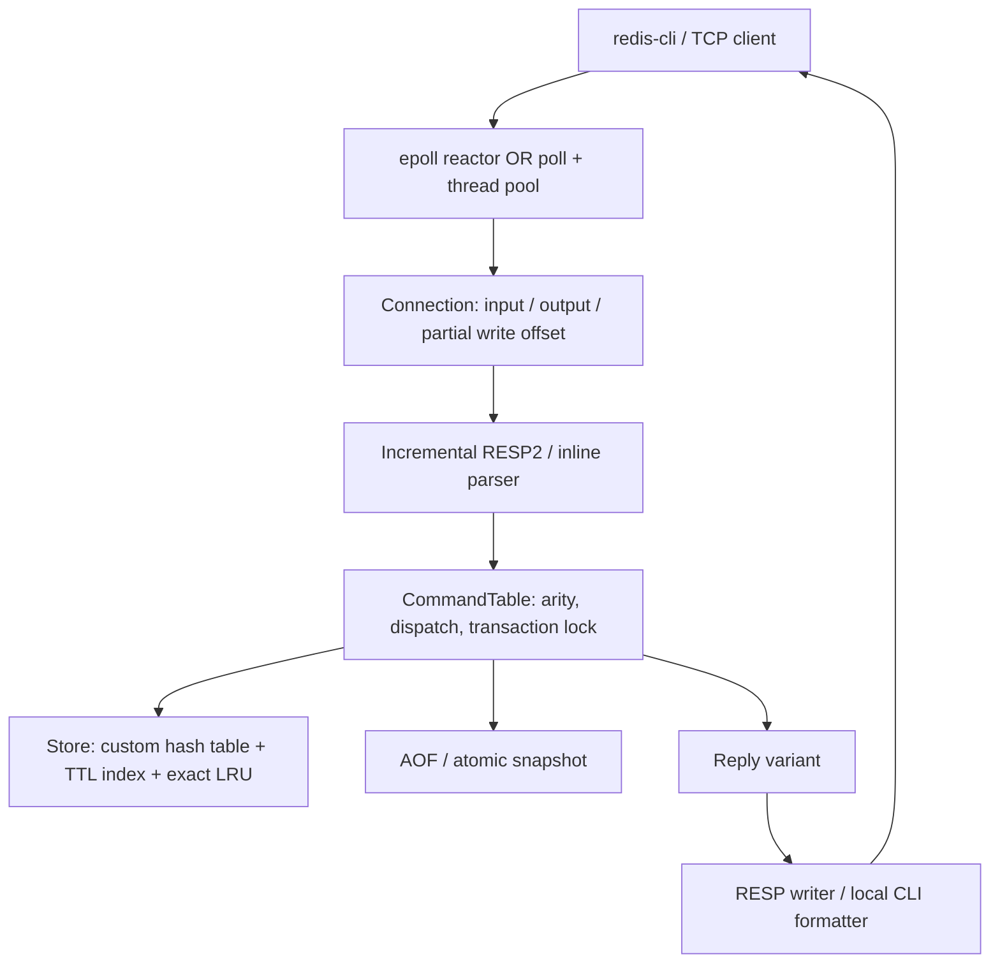

# mini-redis

[](https://github.com/risbh19/mini-redis/actions/workflows/ci.yml)

A string key-value server written from scratch in **C++17**, with a Linux `epoll`
reactor, RESP2, TTL, snapshots, an append-only log, exact LRU eviction, and a custom
hash table that grows and shrinks incrementally. The server has no third-party
runtime dependencies beyond the C++ standard library and Linux APIs. GoogleTest
and Google Benchmark are optional build-time dependencies fetched by CMake.

This is an educational systems project with a defined Redis-compatible **string
command subset**, not a replacement for Redis. Both `redis-cli` and
`redis-benchmark -t set,get` are supported. See [limitations](#limitations) before
using it with a general-purpose Redis client.

## Build and run

Linux with GCC 11+ or Clang 14+, CMake 3.14+, and Python 3 for integration tests.
On Windows, run these commands **inside WSL2 Ubuntu**. Internet access is needed
for the first test dependency download.

```bash
git clone https://github.com/risbh19/mini-redis.git
cd mini-redis
cmake -S . -B build -DCMAKE_BUILD_TYPE=Release
cmake --build build -j 4
ctest --test-dir build --output-on-failure
./build/mini-redis --config mini-redis.conf
```

The default address is `127.0.0.1:6380`; persistent files live in `.data/`.
The startup line `READY 127.0.0.1:6380 epoll` means the socket is listening.
`--port 0` asks the OS for a free port and prints the selected port in that line.

```bash
redis-cli -p 6380 SET name Rishabh EX 60
redis-cli -p 6380 GET name
redis-cli -p 6380 TTL name
redis-cli -p 6380 MSET counter 0 greeting "hello world"
redis-cli -p 6380 INCR counter
redis-benchmark -p 6380 -t set,get -n 100000 -c 50
```

For the local REPL, stop the TCP server first or use a different data directory:

```text
$ ./build/mini-redis --cli --dir .data-repl
mini-redis> SET language "C++17"
OK
mini-redis> GET language
"C++17"
mini-redis> EXISTS language
(integer) 1
mini-redis> EXIT
```

A runtime-only build needs neither GoogleTest nor Python:

```bash
cmake -S . -B build -DCMAKE_BUILD_TYPE=Release -DBUILD_TESTING=OFF
cmake --build build -j 4
```

Docker builds a small runtime image and runs as a non-root user. Use a named
volume to retain the AOF and snapshots when the container is removed:

```bash
docker build -t mini-redis .
docker run --rm --name mini-redis -p 127.0.0.1:6380:6380 \
  -v mini-redis-data:/data mini-redis
```

## Implemented

- [x] Local REPL, quoted inline commands, structured reply variant.
- [x] Binary-safe RESP2 requests/replies, fragmentation, pipelining, parser limits.
- [x] TTL, NX/XX, lazy expiration, bounded random-sampling active expiration.
- [x] Checksummed binary snapshots and automatic startup loading.
- [x] AOF with three fsync policies, absolute expiry, torn-tail recovery,
  transaction boundaries, synchronous compaction, automatic rewrite threshold.
- [x] Nonblocking `epoll`, partial reads/writes, output backpressure, idle timeout,
  max clients, graceful signals, per-directory exclusive process lock.
- [x] Readiness-driven fixed thread pool for comparison; idle sockets do not own workers.
- [x] Custom separate-chaining hash table with incremental growth/shrink, exact LRU,
  approximate dataset memory accounting, atomic `MSET` memory preflight.
- [x] Unit/property/integration tests, sanitizer and fuzz targets, Docker and CI.
- [ ] Sharded command execution with `shared_mutex`; commands currently serialize
  to preserve global exact LRU and AOF ordering.
- [ ] Background AOF rewrite, keyed SipHash, replication, other value types, RESP3.

## Architecture



The reactor executes all commands on one thread. The pool executes socket tasks
on a fixed set of workers; one mutex coordinates each command and its AOF record.
This baseline isolates I/O scheduling costs. It does **not** demonstrate parallel
sharded store execution. More detail: [architecture](docs/architecture.md),
[design decisions](docs/design-decisions.md), [protocol](docs/protocol.md).

## Commands

| Area | Supported commands |
|---|---|
| Strings | `SET k v [EX seconds|PX ms] [NX|XX]`, `GET`, `GETSET`, `APPEND`, `STRLEN` |
| Multiple keys | `MSET k v ...`, `MGET k ...`, `DEL k ...`, `EXISTS k ...` |
| Counters | `INCR`, `DECR`, `INCRBY`, `DECRBY` (signed 64-bit overflow checked) |
| Expiry | `EXPIRE`, `PEXPIRE`, `PEXPIREAT`, `TTL`, `PTTL`, `PERSIST` |
| Keys | `KEYS pattern`, `DBSIZE`, `FLUSHALL` |
| Server | `PING [message]`, `ECHO`, `INFO [section]`, `CONFIG GET pattern`, `CONFIG SET` |
| Persistence | `SAVE`, `BGREWRITEAOF` (synchronous), `SHUTDOWN` |
| Compatibility | `COMMAND [DOCS]` (empty array), `SELECT 0`, `CLIENT SETINFO`, `CLIENT SETNAME`, `QUIT` |

`EXIT` is also accepted by the local REPL. `KEYS` supports `*`, `?`, bracket
classes/ranges/negation, and backslash escapes, and scans the full keyspace.
`DBSIZE` first removes expired entries and also scans the keyspace.
`INFO [section]` currently returns all available sections.

## Configuration

Pass `--config path` then optional `--option value` overrides, or use just flags.
Numeric byte settings use decimal integers, without `mb`/`gb` suffixes.

| Option | Default | Purpose |
|---|---:|---|
| `bind` | `127.0.0.1` | IPv4 listening address |
| `port` | `6380` | TCP port (`0` selects a free port) |
| `dir` | `.data` | Directory for snapshot, AOF, process lock |
| `appendonly` | `yes` | Enable AOF and prefer it on startup |
| `appendfsync` | `everysec` | `always`, `everysec`, `no` |
| `io-model` | `epoll` | `epoll` or `thread-pool` |
| `workers` | `4` | Thread-pool worker count |
| `maxclients` | `10000` | Maximum accepted clients |
| `timeout` | `0` | Idle timeout in seconds; `0` disables it |
| `maxmemory` | `0` | Estimated dataset limit; `0` disables it |
| `maxmemory-policy` | `noeviction` | `noeviction` or `allkeys-lru` |
| `client-output-buffer-limit` | `8388608` | Output watermark that pauses reads/parsing |
| `proto-max-bulk-len` | `536870912` | Maximum single request bulk string |
| `aof-rewrite-min-size` | `67108864` | Auto-rewrite floor; `0` disables auto-rewrite |

Runtime `CONFIG SET` supports `maxmemory` and `maxmemory-policy`. A lowered limit
is enforced by the next allocating write, not by immediately deleting data.
Other parameters require a restart. `CONFIG GET` supports glob patterns.

## Persistence guarantees

| Mode | Before a successful write reply | Crash exposure |
|---|---|---|
| `always` | Complete transaction written and `fsync` completed | Acknowledged writes survive when the OS/device honors fsync |
| `everysec` | Transaction written to the OS; timer attempts fsync every second | Approximately the most recent second on a host/power failure; longer if I/O or command execution stalls |
| `no` | Transaction written to the OS; OS decides when to flush | No bounded power-loss window |
| `appendonly no` | Memory only, until explicit `SAVE` | Everything since the most recent successful snapshot |

`SIGINT`, `SIGTERM`, and `SHUTDOWN` flush dirty AOF data before normal exit.
A process-only `SIGKILL` test does not simulate power failure: OS page cache
usually survives. Snapshots and rewrites fsync a temp file, rename, and fsync
the parent directory. AOF replay discards an incomplete final record or
transaction; malformed complete records abort startup. Snapshot corruption aborts
startup rather than silently replacing the dataset.

If append/fsync fails after a memory mutation, that command returns an error and
future writes are disabled until restart. The in-memory change may be visible;
an error reply is **not** an acknowledgment of durability. See
[persistence formats and failure behavior](docs/persistence.md).

## Verification and measurement

```bash
# Address + undefined behavior
cmake -S . -B build-asan -DCMAKE_BUILD_TYPE=Debug -DSANITIZE=address,undefined
cmake --build build-asan -j 4
ASAN_OPTIONS=detect_leaks=1 UBSAN_OPTIONS=halt_on_error=1 \
  ctest --test-dir build-asan --output-on-failure

# ThreadSanitizer (separate build; never combine with ASan)
cmake -S . -B build-tsan -DCMAKE_BUILD_TYPE=Debug -DSANITIZE=thread
cmake --build build-tsan -j 4
TSAN_OPTIONS=halt_on_error=1 ctest --test-dir build-tsan --output-on-failure

# Parser + AOF fuzzing; each command runs for at least ten minutes
cmake -S . -B build-fuzz -DCMAKE_CXX_COMPILER=clang++ -DBUILD_FUZZER=ON -DBUILD_TESTING=OFF
cmake --build build-fuzz -j 4
python3 scripts/seed_fuzz.py artifacts
./build-fuzz/resp_parser_fuzz artifacts/parser-corpus -max_total_time=600 -max_len=65536
./build-fuzz/aof_fuzz artifacts/aof-corpus -max_total_time=600 -max_len=65536

# Microbenchmarks
cmake -S . -B build-bench -DCMAKE_BUILD_TYPE=Release -DBUILD_BENCHMARKS=ON
cmake --build build-bench -j 4
./build-bench/micro_store_bench

# Load generator against a running server
./build/load_gen --requests 100000 --clients 50 --pipeline 16 --workload mixed
PORT=6380 BUILD_DIR=build bash scripts/run_benchmarks.sh
```

The load generator reports exact sample percentiles for request completion times
measured from the start of each pipeline batch; these are not single-request
service times. Its connection setup and prefill occur before timing starts.
See [benchmark commands, hardware, raw results, and limitations](docs/benchmarks.md)
and [validation record](docs/validation.md). CI also produces a coverage artifact.
No throughput or coverage figure should be copied to a resume without its run context.

## Limitations

- Linux/IPv4 only. No TLS, authentication, ACLs, or hostile-network hardening.
  The default is loopback; expose it only in a trusted environment.
- Strings and one database only. No RESP3, cluster, transactions on the public
  command interface, replication, lists, sets, hashes, pub/sub, or `SCAN`.
- AOF uses RESP2 but is an internal mini-redis format. Snapshot files are not
  Redis RDB files. General Redis backup interchange is not supported.
- The thread pool shares a command mutex. Sharded locking and concurrent store
  access remain future work; exact LRU metadata also requires coordination.
- `SAVE`, `BGREWRITEAOF`, and auto-rewrite block command execution. Large values,
  `KEYS`, `DBSIZE`, and memory-pressure expiry scans can cause latency spikes.
- FNV-1a is deterministic and vulnerable to adversarial hash collisions.
  Rehash work is bounded by migrated nodes, but a collision-chain lookup is not.
- `maxmemory` counts `key.size() + value.size() + 160` per live entry, not RSS.
  It excludes socket buffers, allocator fragmentation, rehash bucket arrays,
  snapshot/rewrite copies, and library/metadata allocation differences.
- The output watermark is soft: one reply can exceed it. Input buffering is
  bounded per connection (513 MiB), not by a global process memory budget.
- Startup reads each persistence file into memory, with a 1 GiB file limit.
- AOF has no checksum: syntactically valid edits can change data undetected.
  The REPL's active-expiry/fsync timer runs between commands, so idle REPL
  durability can lag until the next command or normal exit.

The detailed brief's sharded concurrency, production hardening, and sustained
benchmark matrix are goals, not claims about this implementation.

MIT licensed. See [CHANGELOG](CHANGELOG.md).
