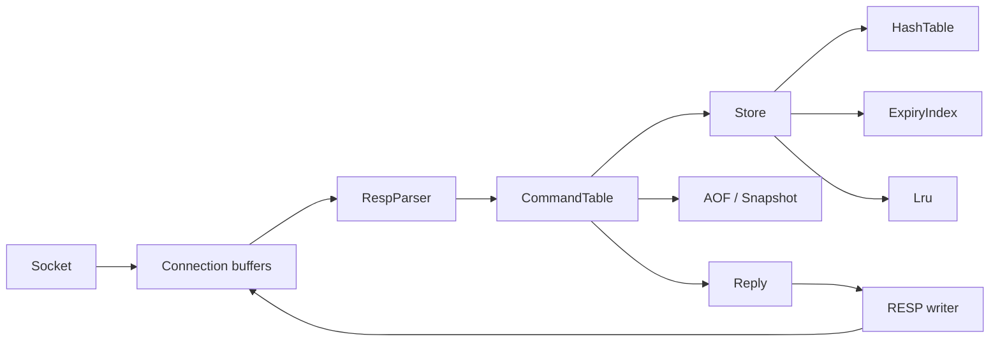

# Architecture

The executable has two front ends. `--cli` reads quoted inline commands from
stdin; the TCP server accepts inline or RESP2 commands. Both feed the same
`CommandTable` and receive a `Reply` variant. Only the final formatter differs.
The store never generates protocol bytes.

## Components

| Directory | Responsibility |
|---|---|
| `core/` | Custom keyspace, clocks, expiration, approximate memory accounting, LRU |
| `protocol/` | Request framing, structured replies, RESP output, REPL formatting |
| `commands/` | Command metadata, arity, validation, execution, persistence coordination |
| `persistence/` | Binary snapshots, CRC32, RESP AOF decode/append/rewrite |
| `net/` | RAII descriptors, sockets, connection buffers, both scheduling modes |
| `config/` | Strict config-file and CLI parsing, selected runtime settings |
| `util/` | Integer overflow checks, glob/inline parsing, structured logging |

## Reactor

`epoll` tells the server which sockets can make progress. A socket in
nonblocking mode returns `EAGAIN` rather than waiting when there is no data or no
send-buffer space. The server retains each client's unread request bytes and
unsent reply bytes between events. For example, a 100-byte reply may require
several `send()` calls; `Connection::sent` advances only by bytes actually sent.
`EPOLLOUT` is enabled while data remains and disabled once the output drains.

The implementation uses **level-triggered** readiness. Each event performs at
most 256 KiB of reading and writing before yielding; level-triggering will
report remaining work again. Accepts are capped at 128 per event. This bounds
socket work, not the cost of executing a single command. Unique connection IDs
in `epoll_event.data.u64` avoid interpreting stale events for reused file descriptors.

Parsing pauses at the output watermark; new reads are also paused. When writes
make space, parsing resumes from input already buffered in user space. This is
necessary even if the kernel has no new readable bytes. Peer half-close drains
complete requests and replies before the socket closes. Protocol errors append
one error reply and then close after flushing.

The loop checks timers every 100 ms, including under sustained traffic. Timers
sample TTL keys and invoke AOF fsync/rewrite checks. Idle timeout uses the
monotonic clock. The main thread handles termination signals and then flushes AOF.

## Thread pool

An acceptor uses `poll` to find ready, non-busy connections and submits bounded
I/O tasks to a fixed worker queue. At most one task owns a connection at a time.
Workers notify the acceptor through `eventfd` when a task finishes, so it can
register the connection's new read/write interests without a polling delay.
Idle connections do not reserve workers. Shutdown wakes sockets, drains tasks,
joins workers, and releases descriptors through RAII.

The registry mutex protects scheduling ownership; it is not held while a command
executes. A separate command mutex serializes store changes, LRU, expiry, stats,
and AOF writes. Multiple-key operations are atomic with respect to other client
commands. This is a correctness baseline, **not the brief's sharded shared-lock
implementation**. A fair comparison must describe that distinction.

## Keyspace and clocks

`HashTable<Entry>` owns collision nodes with `unique_ptr`. During rehash both old
and new bucket arrays exist; lookups search both. Every mutating lookup migrates
up to two nodes or empty buckets. Growth begins at load 1 and shrink below 0.1,
with a minimum of eight buckets. Visitors cannot mutate the table or retain
references across operations. Reservoir random-key selection is O(N); the TTL
sampling index provides O(1) random selection separately.

An entry has a string value and optional monotonic deadline. `IClock` exposes
both monotonic and Unix milliseconds. A running key's duration ignores wall
clock jumps; persistence converts its remaining duration to a Unix deadline.
After restart, already expired keys are skipped, and live absolute deadlines
are converted back to monotonic durations. `FakeClock` tests both time domains.

Active expiration samples up to 20 keys per batch from a vector plus position
map, removes entries by swap-with-last, and repeats while more than 25% expire.
One cycle stops after 1 ms or 1000 samples. Lazy expiration checks every access.
Memory-pressure, `KEYS`, and `DBSIZE` cleanup use a full scan for correctness.
